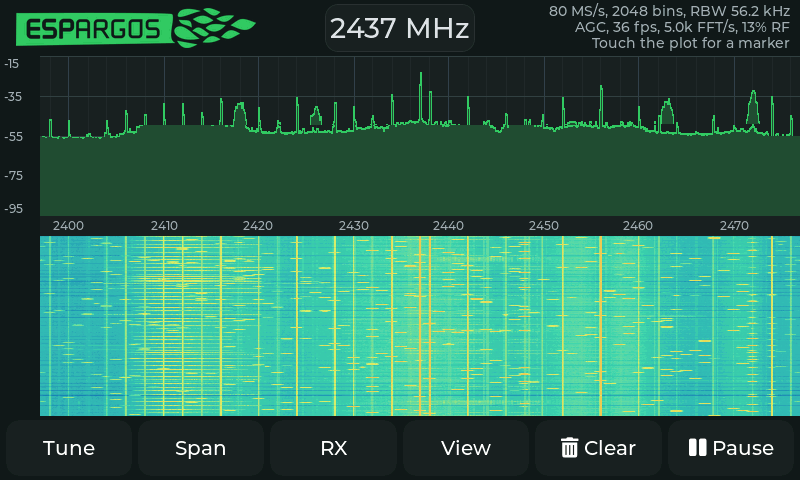
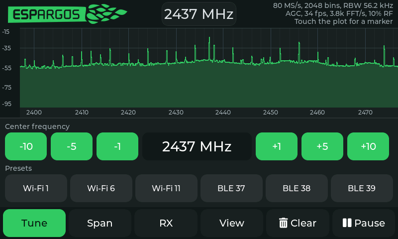

# ESP32-S31-Korvo-1: stand-alone LCD spectrum analyzer

The `esp32s31-korvo` profile turns the ESP32-S31-Korvo-1 development board
with its ESP32-S3-LCD-EV-Board-SUB3 display into a self-contained touch
spectrum analyzer. The S31 captures I/Q snapshots, computes FFTs on its
second core, and draws the spectrum and waterfall on the 800×480 panel.
Nothing is transferred to a computer, so the waterfall scrolls at the
panel's own refresh rate.





The profile uses preview ESP-IDF support for the S31 and the same undocumented
TCM dump path as the serial burst firmware. Keep the pinned SDK revision from
[firmware-targets.json](../firmware-targets.json).

## Hardware

| Part | Detail |
| --- | --- |
| Module | ESP32-S31-WROOM-3, 16 MB flash, 16 MB octal PSRAM |
| Display | 4.3″ 800×480 RGB565 panel (ST7262), 16-bit RGB interface, 18 MHz pixel clock |
| Touch | GT1151 capacitive multi-touch on I2C (GPIO0 SDA, GPIO1 SCL), polled |
| Console | CP2102N USB-to-UART bridge on GPIO58/59, 2 Mbaud |
| Flashing | Same UART; the installer uses 921600 baud |

GPIO8–19, 33–36, 38, 40 and 43–45 belong to the LCD, so the PARLIO loopback
lanes of the streaming firmware are unavailable. The Korvo profile therefore
relies on the snapshot engine, not on continuous capture.

## Using the analyzer

The layout is made for fingers on a 4.3" panel: the plot spans the full
width, the top bar holds the frequency readout and the status lines, and a
toolbar of six large buttons sits along the bottom. Every control is at least
56 px tall.

- **Tune, Span, RX, View:** each opens a sheet over the waterfall while the
  spectrum above keeps running, so the effect of a change is visible at once.
  Tap the same button again (or another sheet) to close it; the waterfall
  returns with the rows recorded in the meantime.
- **Center frequency:** tap the readout in the top bar (or in the Tune sheet)
  for a keypad, or use the ±1 / ±5 / ±10 MHz buttons. Presets cover Wi-Fi
  channels 1/6/11 and the BLE advertising channels 37/38/39. Any integer MHz
  from 100 to 6000 is accepted as a tuning attempt, like the serial firmware.
- **Marker:** touch or drag on the plot; the third status line shows the
  frequency and level under your finger. Touching the plot never changes the
  tuning. Tap that line, or Clear, to remove the marker.
- **Span sheet:** sample rate 80/40/20/10/8/4 MS/s (the displayed span), FFT
  size 256–2048, and the zero-IF handling: show the DC spike as is, fill the
  centre bins, or offset the LO by 5 MHz (2 MHz below 40 MS/s) so the tuned
  frequency stays away from 0 Hz. The dashed line marks the requested centre
  when the LO is offset.
- **RX sheet:** hardware AGC or a manual gain index, open or filtered analog
  bandwidth (13–54 MHz), each with a slider that is greyed out while AGC or
  the open bandwidth is selected.
- **View sheet:** floor and range in dBFS, trace averaging, average or peak
  detector, max-hold trace and automatic scaling.
- **Clear** resets traces, waterfall and marker; **Pause** freezes capture.

Settings persist in NVS two seconds after the last change. Levels are
uncalibrated dBFS relative to a full-scale complex tone through the same
window and FFT; they are comparable between settings but not absolute power.

## Architecture

| Core | Task | Role |
| --- | --- | --- |
| 1 | `analyzer` | Captures 16380-sample TCM snapshots back to back, unpacks and windows them with the S31 SIMD kernels, runs the rounded Q15 FFT, and sums the per-bin power in the SIMD accumulator lanes (max hold uses a plain loop). |
| 0 | `render` | Fetches the merged spectrum once per display frame, updates trace, max-hold and waterfall history, and paints the plot. |
| 0 | `LVGL` | Widgets, touch input and the settings logic (`esp_lvgl_port`). |
| 0 | `screenshot` | Console commands and frame-buffer dumps over UART0. |

The analyzer merges every FFT computed since the previous fetch, so each
displayed row averages all RF captured in that frame interval. A snapshot
covers 16380 samples (205 µs at 80 MS/s); a 2048-point block costs about
165 µs on the SIMD core (unpack 9k, FFT 40k, power sum 4k cycles), so
coverage of the RF time is about 13 % at 80 MS/s with 5000 FFT/s. At low
sample rates the snapshot itself lasts milliseconds and the limiter that keeps
the UI core running at least half of the time caps coverage near 40 % at
4 MS/s. Short packets can fall between snapshots, as with the burst firmware. Continuous bank rotation (`SPEC` mode of the serial
firmware) is not used: its poller needs a core with interrupts disabled, which
would leave no core for the display.

The spectrum is drawn directly into the PSRAM frame buffer from per-column
tables and written back once per frame. The waterfall is a ring image in
PSRAM; each frame adds one row and the pixel processing accelerator copies the
ring into the frame buffer as two blocks. On the bench board a frame takes
about 12 ms and the display updates at the panel's 34–35 Hz refresh with
2048 bins.

### Memory and capture rules

- The RF dump owns the complete upper 128 KiB SRAM group (0x2f060000 and up)
  while the gate is open. It is excluded from the heap and the linker guard
  keeps static data below it.
- The UI core is halted (`esp_ipc_isr_stall_other_cpu`) for the duration of
  every snapshot. Running it concurrently corrupted internal RAM within
  seconds on the bench board. The analyzer limits snapshots to half of the
  time, so the display stays responsive at low sample rates.
- Flash writes stall the other core too; two cores stalling each other
  deadlock in the IPC spinlock. Settings are therefore saved only after the
  analyzer has acknowledged that it is idle.
- The heap allocator is linked from source: with the ROM TLSF copy of the
  rev0 chip, frees from LVGL crashed inside the ROM vtable.
- SIMD kernels cannot read LP/RTC RAM, which is kept out of the heap.
- `s31_power.S` keeps the per-bin sums in the eight 64-bit lanes of the SIMD
  accumulator, loading and storing them as plain `uint64_t[8]` per group of
  eight bins; a self-test at setup compares it with the C sum. The sums are
  converted with two 32-bit FPU conversions, because libgcc's 64-bit
  conversion made the per-frame publish slower than the FFTs it summarised.
- LVGL's draw buffer, the waterfall history and the published spectra live in
  PSRAM; the FFT work set and the analyzer stack stay in internal SRAM.
- The render task draws a frame while holding the LVGL lock, so widgets never
  flush over the plot and touch handlers never wait for the renderer (an
  earlier handshake deadlocked when the keypad opened mid-frame).
- The ESPARGOS wordmark in `logo.c` is an alpha-only LVGL image generated by
  `tools/korvo_logo.py` from the SVG in esp-web-sdr; LVGL recolors it.

## Build and flash

```sh
idf.py --preview -B build-korvo -DIDF_TARGET=esp32s31 -DESP_SDR_KORVO=ON \
  -DSDKCONFIG=build-korvo/sdkconfig \
  -DSDKCONFIG_DEFAULTS=sdkconfig.defaults.esp32s31-korvo build
idf.py --preview -B build-korvo -p /dev/ttyUSB1 -b 921600 flash
```

The profile pulls `lvgl/lvgl`, `espressif/esp_lvgl_port` and
`espressif/esp_lcd_touch_gt1151` from the component registry; their versions
are pinned in `main/targets/esp32s31/korvo/idf_component.yml` and
`dependencies-korvo.lock`. `tools/build_firmware.py --profile esp32s31-korvo`
builds and exports it like every other profile, and the browser installer
offers it as "ESP32-S31-Korvo-1 · LCD spectrum analyzer".

## Console

UART0 (2 Mbaud) carries the log and accepts one command per line. They drive
the same settings as the touch controls and exist for scripted checks:

```
SHEET n     open sheet 0..3, 4 closes  FREQ mhz    centre frequency
RATE n      rate code 0..5             NFFT n      FFT size index 0..3
DC n        0 raw, 1 fill, 2 offset    GAIN n      manual gain index
AGC         hardware AGC               BW mhz      filter (0 = open)
MARKER x    marker column              HOLD / MAX  toggle max-hold trace / detector
PAUSE / CLEAR / KEYPAD / AUTOSCALE                 toggles
SHOT        raw RGB565 frame-buffer dump
```

`tools/korvo_screenshot.py out.png --command "SHEET 1"` saves the current
screen as PNG (needs `pyserial` and `pillow`). Every five seconds the log
reports frame rate, render time, FFT rate, snapshot rate, RF coverage and the
core-1 load.

## Limitations

- Receive only, 2.4 GHz front end; the tuning range is an attempt range as
  for the other S31 profiles.
- Snapshot coverage, not gap-free capture.
- No GPIO output controls: the free pins are taken by the display, audio and
  SD card.
- Single frame buffer; a scrolling waterfall hides tearing well, but a fast
  trace can show a seam.
